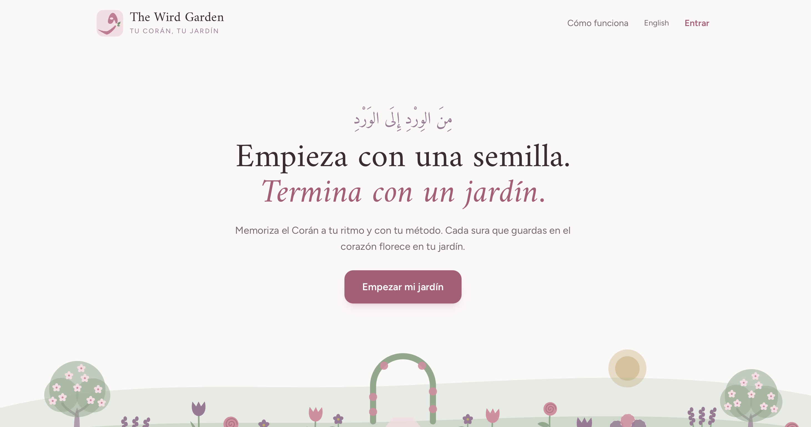
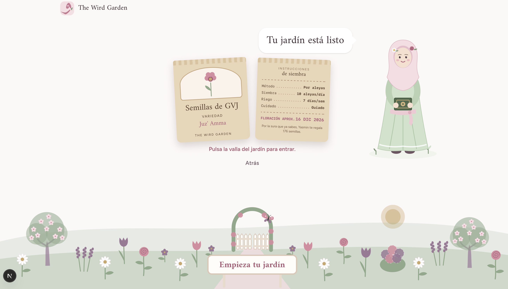

<p align="center">
  
</p>

<h1 align="center">The Wird Garden</h1>

<p align="center">
  <em>Start with a seed. End with a garden.</em><br />
  A gentle web app to memorize the Quran at your own pace, where every surah you learn blooms in your garden.
</p>

<p align="center">
  
  
  
  
</p>

---

## About

**The Wird Garden** helps you build a daily *wird* (your daily portion of the Quran) and turn it into a habit of memorization (*hifz*).

The name comes from Arabic: **wird** (وِرْد, a daily portion) and **ward** (وَرْد, roses) are written with the same letters and differ by a single vowel. Day by day, your wird becomes a garden of roses.

The app is designed mainly for women, with a soft, floral identity and two characters who guide you:

- **Aya** walks with you through your plan, your lessons and your reviews.
- **Yasmin** is the gardener: she looks after your seeds and your garden.

## Features

### Available now

- 🌱 **Personalized onboarding** – Aya asks a few questions (surahs you already know, goal, method, pace, days per week) and builds your plan.
- 📅 **Estimated finish date** – calculated from your goal and pace, minus what you already know.
- 🌷 **A garden that grows** – it blooms as you answer, and your plan is handed to you as a seed packet.
- 🌍 **Bilingual** – Spanish and English, with more languages planned.
- 📱 **Responsive** – designed for desktop and mobile.

### On the roadmap

- [ ] Memorization screen: Quran text, ayah-by-ayah audio and a repetition counter
- [ ] Several methods: by ayah, by third of a page, by half page or by full page
- [ ] Accounts and progress tracking per surah, juz' and overall
- [ ] Spaced-repetition review ("reviewing is watering")
- [ ] The real garden: every memorized surah becomes a plant
- [ ] Streaks and daily reminders
- [ ] Installable app (PWA)

## Screenshots

<!-- Add screenshots to docs/screenshots/ and they will show up here -->
<p align="center">
  
  
</p>

## Tech stack

| Area | Tools |
| --- | --- |
| Framework | [Next.js 16](https://nextjs.org/) (App Router, React Server Components) |
| Language | TypeScript |
| Styling | [Tailwind CSS 4](https://tailwindcss.com/) |
| Internationalization | Next.js built-in i18n with JSON dictionaries |
| Illustrations | Hand-made SVG components with CSS animations |
| Quality | ESLint, GitHub Actions (lint + build on every pull request) |

Everything is built with **free and open-source tools**.

## Getting started

You need [Node.js](https://nodejs.org/) 20 or later.

```bash
# Clone the repository
git clone https://github.com/sarah-guellil/the-wird-garden.git
cd the-wird-garden

# Install dependencies
npm install

# Start the development server
npm run dev
```

Then open [http://localhost:3000](http://localhost:3000).

Other useful scripts:

```bash
npm run lint    # Check the code
npm run build   # Build for production
```

## Project structure

```
src/
├── app/[lang]/          # Pages, one version per language (es, en)
│   ├── page.tsx         # Home page
│   ├── start/           # Onboarding
│   └── garden/          # The user's garden (coming soon)
├── components/
│   ├── characters/      # Aya and Yasmin
│   ├── garden/          # Garden scene, plants, butterfly
│   └── onboarding/      # Onboarding flow and seed packet
├── i18n/                # Language config and dictionaries (es.json, en.json)
├── lib/                 # Plan logic and surah data
└── proxy.ts             # Redirects each visitor to their language
```

## Workflow

- `main` – stable version
- `develop` – integration branch
- `feature/*`, `docs/*` – one branch per change, merged into `develop` through a pull request

Every pull request runs lint and build automatically before it can be merged.

## Quran text and audio

The Quran text and recitations will be streamed from public sources with clear terms of use. No audio files are hosted in this repository. The exact sources and their licenses will be listed here once they are integrated.

## Authors

Made with care by [Sarah Guellil](https://github.com/sarah-guellil).

## License

The source code is released under the [MIT License](LICENSE). The Quran text and recitations belong to their respective sources and are subject to their own terms.